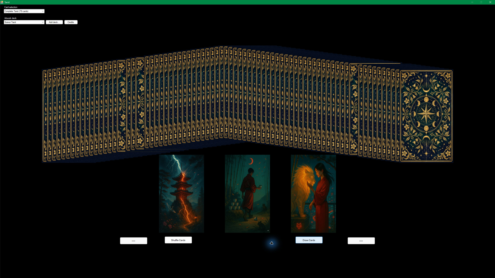

# TarotDeck

A Windows Forms tarot card picker built with .NET Framework 4.8.

## Deck options

Choose a card set and an artwork deck independently:

- **Card selection:** Complete Tarot (78 cards), Major Arcana (22 cards), or Minor Arcana (56 cards).
- **Artwork deck:** Classic Tarot (included) or Soimoi Tarot (included). The selected card set and artwork deck are remembered for the next launch.
- **Add deck…:** Import any complete artwork folder. The app checks for all 78 cards and a card back, then copies the artwork into your local app data folder.

### Image names for custom decks

Put the images in one folder. Use `cardback.jpg` and these card filenames (the app also accepts `.jpeg`, `.png`, or `.bmp` extensions):

- `maj01` through `maj22`
- `cups01` through `cups14`
- `pents01` through `pents14`
- `swords01` through `swords14`
- `wands01` through `wands14`

The names are case-insensitive. In the app, click **Add deck…** and choose the folder. Imported sets are stored under `%LOCALAPPDATA%\TarotDeck\Decks` and appear in the artwork selector.

## Artwork credits

The Soimoi Tarot images are by Mike Koz and licensed under [Creative Commons Attribution 4.0](https://creativecommons.org/licenses/by/4.0/). Suggested credit: “Soimoi Tarot” by [Mike Koz](https://koz.tv/), licensed under CC BY 4.0. The source license is included at `TarotDeck/images/soimoi/LICENSE`; the filenames were adapted for this application. The custom Soimoi card back was created for TarotDeck.

## Build and run

Open `TarotDeck.sln` in Visual Studio and build the `TarotDeck` project. It targets .NET Framework 4.8 and x86. Card images are copied beside the executable during build.
